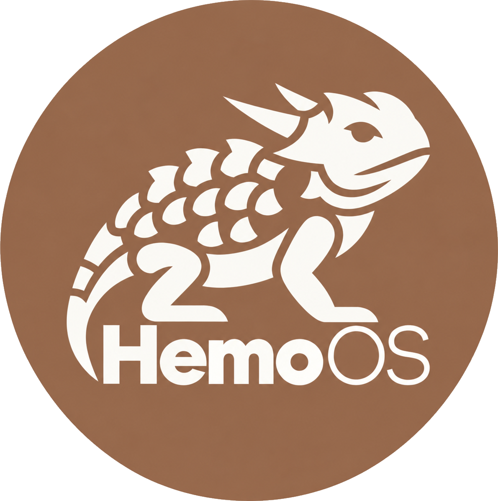

<div align="center">



**A curated Kali Linux workstation for cybersecurity professionals.**

[](LICENSE)
[](https://www.kali.org/)
[](https://i3wm.org/)
[](#get-hemo)

</div>

Hemo is a tuned, version-controlled Kali workstation that ships as a ready-to-run
VMware image. The desktop, shell, and operator workflow are baked once and kept in this repository.
The offensive and defensive tools are not baked in. They install per *role* on
first boot, so a box carries the full kit for its discipline and none of another's.

Hemo is a workstation you build for the work in front of you, not one you carry
day to day. You forge a curated image from code, then clone or rebuild it per
engagement so each job starts from a known, reproducible base. Add the roles a
job needs and leave the rest out.

The name is the Texas horned lizard, *Phrynosoma*: spiny, armored, and at home in
hostile terrain. The default user, `hemo`, is a nod to its best-known defense,
squirting blood from its eyes.

## Highlights

- **Made for VMware.** Hemo ships as a single OVA you import in one step.
  VMware Tools (open-vm-tools) is baked in, so clipboard, drag and drop, and
  resizing work from the first login.
- **Role-based tools.** Eight personas (Red Team, Pentest, Web, Reverse, two Blue
  Team roles, Vulnerability Assessor, and Full) each install a hand-picked tool set.
  Pick one or several; add more later with `hemo-roles`.
- **A desktop that themes itself.** An i3 setup where the wallpaper, bar, terminal,
  editor, notifications, and prompt all recolor to the active role's accent, in both
  light and dark modes.
- **Report-ready by design.** The terminal opens at a fixed size, and the capture
  helpers save framed, consistent screenshots into the active engagement.
- **A workspace per client.** `eng new <client>` (short for `hemo-engagement`) makes
  `~/engagements/<client>/`; screenshots, notes (`eng log "…"`), the bill of materials
  and tmux pane logs follow whichever engagement is active. While one is active,
  every command gets a dated stamp and the prompt shows the client and the IP a
  target would see. Target and engagement live in files, never exported variables.
- **Transfer and trust helpers.** `hemo-serve` serves files on your VPN address with
  upload on; `hemo-verify` checks a release download against the baked signing key.
- **Operator-controlled updates.** Tools install current at setup, then freeze during
  an engagement and update deliberately between. `hemo-bom` records exactly what is
  installed, per job.

## Get Hemo

Hemo ships as a prebuilt VMware image (`.ova`) for VMware Workstation, Player, and
Fusion. Download it from the [Hemo OS page](https://cnmoseman.github.io/hemo-os/); each
[GitHub release](https://github.com/cnmoseman/hemo-os/releases/latest) carries the signed
`SHA256SUMS` to check it.

Import the image, boot it, and log in as `hemo` with password `hemo` (like Kali's
`kali`/`kali`; change it with `passwd`).
**Hemo Welcome** opens so you can pick your role(s); their tools install online.

## Roles

Each role installs a hand-picked tool set when you select it. The first role you pick
is your *primary*: it sets the wallpaper, accent, and bookmarks. Switch the primary
later with `hemo-theme <role>`. Open a role for what it covers, who it is for, and
its full tool list.

- **[Red Team](docs/roles/red-team.md):** C2, post-exploitation, lateral movement, evasion, and AD compromise (91 tools).
- **[Penetration Testing](docs/roles/penetration-testing.md):** generalist assessment across recon, AD, web, passwords, and exploitation (127 tools).
- **[Web & API Testing](docs/roles/web.md):** web and API application testing (39 tools).
- **[Reverse Engineering](docs/roles/reverse-engineering.md):** binaries, Android/Java, and recovered-artifact analysis (26 tools).
- **[Blue Team Host Analyst](docs/roles/blue-host-analyst.md):** host and endpoint DFIR: forensics, triage, malware, and audit (29 tools).
- **[Blue Team Network Analyst](docs/roles/blue-net-analyst.md):** network security monitoring: IDS, traffic, and flow analysis (15 tools).
- **[Vulnerability Assessment](docs/roles/vulnerability-assessor.md):** authenticated and unauthenticated scanning, triage, and reporting (14 tools).
- **[Full Scope](docs/roles/full-scope.md):** every role's tools combined, for purple-team work and labs (all roles' tools).

## The desktop

i3 on X11, with a set of `hemo-*` helpers wired to the keyboard. A few of the bindings
(`$mod` is the Super key by default):

| Keys | Action |
|------|--------|
| `$mod + Return` | Terminal (kitty) |
| `` $mod + ` `` | Drop-down terminal |
| `$mod + d` | App launcher (pinned apps first) |
| `$mod + b` | Browser (sandboxed Firefox) |
| `$mod + Shift + d` | Settings / control center |
| `$mod + p` | Toggle the report-screenshot layout |
| `Print` | Annotated capture (Flameshot) |
| `$mod + Print` | Capture the active window to a framed PNG |
| `$mod + Shift + x` | Lock screen |
| `$mod + Shift + e` | Power menu |
| `$mod + /` | Searchable list of every key binding |

New windows open where the mouse is: `hemo-open` wraps the launch keys above and
puts the new tile on the side of the focused tile nearest the pointer — top half →
on top, left half → on the left, and so on. Scale-free (works on wide and tall tiles)
and robust to the autotiling helper; tune the bias in `~/.config/hemo/open.conf`
(`hemo-open --help`).

Theming runs through one script, `hemo-role-apply`, which rewrites the colors across
kitty, polybar, rofi, dunst, GTK, i3, Firefox, btop, Neovim, fastfetch, and more on
every role, accent, or light/dark change. **Hemo Welcome** (`hemo-welcome`) is the GUI
control center for roles, appearance, and setup.

## Repository layout

```
provision.sh                Hand-build path: turn a fresh Kali VM into Hemo.
declutter.sh                Strip Kali's stock toolset (dry-run by default).
build.sh                    Release pipeline: one rootfs, exported per VM format.
manifest/                   Package and role definitions:
  apt.yml                   Baked base + the per-role tool catalog (Kali repo).
  extra.yml                 pipx / go / git / .deb tools, version-pinned.
  roles.yml                 Personas: tools, accent, wallpaper, bookmarks.
  remove.yml                Packages purged from the base.
overlays/                   Files laid into the image:
  etc/skel/                 Per-user config: i3, kitty, zsh, fastfetch, …
  usr/local/bin/            The hemo-* helpers and the report-capture tools.
branding/                   Visual identity:
  assets/                   Logos, marks, and the wordmark.
  wallpapers/               Base, role, and login art.
  grub/ plymouth/ lightdm/  Boot and login theme files.
  install-branding.sh       Applies the themes.
scripts/                    In-rootfs customization hook for the build pipeline.
firstboot/                  First-boot identity reset and role picker.
docs/                       Role pages, the default-apps list, and README assets.
PLAN.md, RUNBOOK.md         Design doc and hand-build runbook.
```

## Build a release image

Releases are built by hand in VMware:
provision a stock Kali VMware VM with `provision.sh`, declutter it, apply the golden
config, seal it offline from a Kali Live ISO, export the OVA, then check, sign and upload it
with `scripts/hemo-release-pack.sh`. Hemo ships for VMware only.

`build.sh` (Kali's `kali-vm` pipeline, which needs a Linux host with `/dev/kvm`) is
kept for reference but is not the release path.

## Documentation

- [Default apps](docs/default-apps.md): every app baked into the base, before any role.
- [`PLAN.md`](PLAN.md): architecture, the role-install model, build flow, and the
  decisions behind them.
- [`RUNBOOK.md`](RUNBOOK.md): hand-building a VMware image, per-engagement cloning,
  renaming the operator, and report-screenshot setup.

## Status

The first release, 0.1.0, is a VMware OVA. Hemo ships for VMware only; there are no
qcow2 or VirtualBox images.

## Scope and legal

Hemo is a toolkit for **authorized** security work. Use its offensive capabilities
only against systems you have explicit, written permission to test. You are
responsible for complying with all applicable laws.

Hemo is an independent project based on Kali Linux. It is not affiliated with or
endorsed by OffSec. "Kali Linux" is a trademark of OffSec. Each bundled tool and
package remains under its own license.

## License

Hemo's own scripts, configuration, and build files are released under the
[GNU General Public License v3.0](LICENSE). Tools and packages that Hemo installs keep
their respective upstream licenses.
